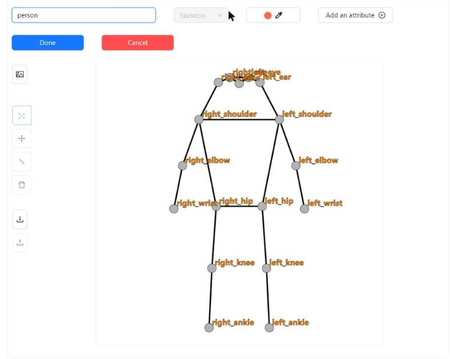
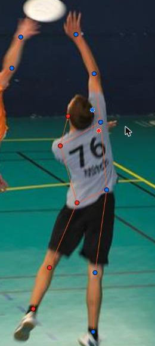
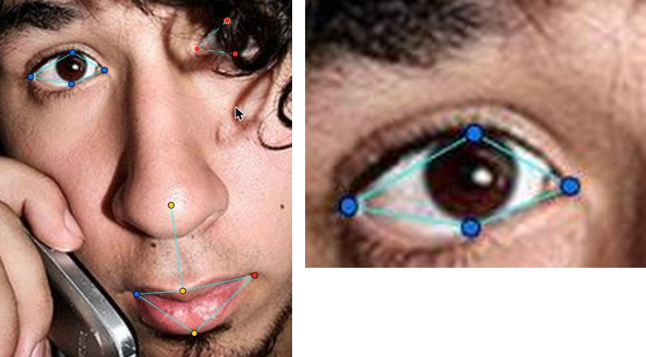
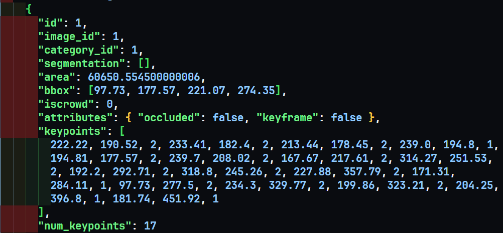

# Báo cáo cá nhân — HoVaTen-MSSV

Đổi tên file theo quy tắc `MSSV_HoTen.md`. Ví dụ: `20241234_NguyenVanAn.md`.

Dữ liệu: 12 ảnh người COCO val2017 (Lin et al., 2014) và 8 ảnh chân dung Wikimedia Commons, chỉ dùng trong lớp.

## 0. Thông tin học viên

- Họ tên: Doãn Tùng Lâm
- MSSV: 2A202603227
- Email: 26ai.lamdt2@vinuni.edu.vn
- Link repository: https://github.com/doantunglam/K5-L2-DAY04-DoanTungLam-2A202603227-KeypointPose
- Phiên bản CVAT (Help → About): 2.74.1
- Máy: hệ điều hành Windows · RAM 16 GB · chạy CVAT chế độ đầy đủ
- Bộ ảnh (`src/exports/assignment.json` do `lab.py setup` tạo): có
- Giờ bắt đầu: 16h30
- Giờ kết thúc: 20h00

## 1. Kiểm tra label (CP0)

| Label    | Kiểu     | Số điểm | Tên điểm đúng bảng của lab? | Đúng thứ tự? | Số cạnh |
| -------- | -------- | ------: | --------------------------- | ------------ | ------: |
| `person` | Skeleton |      17 | Có                          | Có           |      19 |
| `face`   | Skeleton |      13 | Có                          | Có           |      13 |

Mẫu `person` dựng theo người quay mặt về camera (các điểm `left_*` nằm bên phải khung mẫu)?
  - Có. Trong constructor, left_shoulder nằm bên phải khung mẫu và right_shoulder nằm bên trái.

Cách đổi cờ `occluded` / `outside` cho **một điểm** trên phiên bản CVAT này (một câu):

- Chọn điểm cần đổi, rồi bật Occluded bằng phím Q (hoặc /) hoặc Outside bằng phím O (hoặc bấm biểu tượng tương ứng trong panel đối tượng bên phải)

## 2. Số lượng đã gán và thời gian (CP1, CP2)

| Nhóm ảnh   | Số ảnh | Số skeleton đã gán | Số người dưới 60 px (không gán) | Số poster / gương / màn hình bỏ qua | Thời gian (phút) |
| ---------- | -----: | -----------------: | ------------------------------: | ----------------------------------: | ---------------: |
| `easy`     |      5 |                  5 |                               0 |                                   0 |               15 |
| `occluded` |      3 |                  5 |                               2 |                                   0 |               15 |
| `back`     |      2 |                  4 |                               0 |                                   0 |               10 |
| `small`    |      1 |                  3 |                               7 |                                   0 |               10 |
| `crowd`    |      1 |                  3 |                               0 |                                   0 |               10 |
| `faces`    |      8 |                  8 |                               — |                                   0 |               20 |

- Số ảnh người đã xong ở mốc phút 105: 10 / 10
- Thời gian thực tế (phút): CP1 50m · CP2 30m · CP3 20m
- Ảnh tốn thời gian nhất là ảnh nào, vì sao?

    - Ảnh tốn thời gian nhất là ảnh `000000269462.jpg`. Vì có tới 3 đối tượng cần dựng skeleton đồng thời ba đối tượng đều có kích thước nhỏ và quay lưng về phía camera nên sẽ có những phần bị che khuất cần căn chỉnh cho đúng

## 3. Bảng ca khó (CP1, CP2)

Mỗi điểm bạn phân vân một dòng, nhất là phân vân giữa `v = 1` và `v = 0`, hoặc không chắc hướng người.

| Ảnh                | Người / mặt | Điểm                           | Cờ đã chọn | Phân vân giữa                                                      | Lý do chọn                                                                                                                        |
| ------------------ | ----------- | ------------------------------ | ---------: | ------------------------------------------------------------------ | --------------------------------------------------------------------------------------------------------------------------------- |
| `face_146049.jpg`  | mặt         | Tất cả các điểm của 2 bên mắt  |          0 | `occluded` và `outside`                                            | Kính che toàn bộ 2 bên mặt. Không thể xác định được vị trí cụ thể các điểm của 2 mắt                                              |
| `face_41666.jpg`   | mặt         | 4 điểm thuộc mắt trái          |          1 | `occluded` và `outside`                                            | Một phần tóc che mất các ví trị đặt mắt trái, tuy nhiên vẫn có thể dự đoán được vị trí 3 trên 4 điểm                              |
| `000000183176.jpg` | người       | Tất cả điểm của người ngồi sau |          0 | Việc chọn một vái điểm có thể nhìn thấy với việc không vẽ người đó | Mặc dù có thể xác định một phần cơ thể (2 đầu gối), tuy nhiên nó sẽ không có ý nghĩ gì nếu chỉ có thể xác định được 2 bên đầu gối |

## 4. Bảng tự review (CP3)

Đi từ ảnh cuối về ảnh đầu. 5 ảnh người (ít nhất 2 ảnh `back` hoặc `crowd`) và 3 ảnh mặt. Ít nhất 8 dòng, kể cả dòng `ok`. Ghi lỗi trước, sửa sau.

Mã lỗi dùng đúng một trong: `lr_swap`, `vis_flag`, `position`, `missing`, `extra`, `ok`.

| Ảnh                 | Người / mặt             | Điểm                                                                     | Mã lỗi     | Ghi chú                                                                                                          | Đã sửa? |
| ------------------- | ----------------------- | ------------------------------------------------------------------------ | ---------- | ---------------------------------------------------------------------------------------------------------------- | ------- |
| `000000019754.jpg`  | Người                   | `LEFT_HIP`                                                               | `vis_flag` | Hông bên trái của người không bị mất hoàn toàn khỏi hình, vẫn có thể đoán được vị trí                            | Có      |
| `0000000157271.jpg` | Người áo trắng phía sau | `LEFT_ELBOW`                                                             | `vis_flag` | Khuỷu tay trái bị che nhưng vẫn có thể xác định được thông qua cổ tay trái, không tính outside                   | Có      |
| `0000000163118.jpg` | Người mặc áo cam        | `LEFT_ELBOW`                                                             | `vis_flag` | Khuỷu tay trái bị che hoàn toàn, đồng thời cổ tay cũng bị che phần lớn, nên không xác định được, tính là outside | Có      |
| `0000000183176.jpg` | Người đàn ông lái xe    | `LEFT_KNEE`                                                              | `vis_flag` | Tâm đầu gối trái nằm dưới mép ảnh, lại bị đèn xe che -> đánh là `outside` thay vì `occluded`                     | Có      |
| `0000000272026.jpg` | Người áo trắng phía xa  | `LEFT_ELBOW`                                                             | `vis_flag` | Khuỷu tay trái bị che hoàn toàn bởi người phía trước và chiếc bàn -> đánh là `outside`                           | Có      |
| `face_145621.jpg`   | Mặt                     | -                                                                        | `ok`       | Mọi điểm đều có thể xác định được rõ ràng                                                                        | -       |
| `face_41666.jpg`    | Mặt                     | `LEFT_EYE_LOWER`                                                         | `vis_flag` | Điểm dưới mắt bị che nhưng vẫn có thể xác định được thông qua các điểm còn lại                                   | Có      |
| `face_425647.jpg`   | Mặt                     | `LEFT_EYE_LOWER`, `LEFT_EYE_UPPER`, `RIGHT_EYE_LOWER`, `RIGHT_EYE_UPPER` | `position` | Mắt người bé, dễ đặt lệch khỏi tâm khớp                                                                          | Có      |

Tổng hợp số lỗi theo mã:

| `lr_swap` | `vis_flag` | `position` | `missing` | `extra` | `ok` |
| --------: | ---------: | ---------: | --------: | ------: | ---: |
|         0 |          6 |          1 |         0 |       0 |    1 |

Điểm còn phân vân giữa `v = 1` và `v = 0` (ghi cả hai lựa chọn và lý do chọn):

Điểm `LEFT_KNEE` của người đàn ông lái xe ở `000000183176.jpg`. Phân vân giữa v = 1 (đầu gối bị đèn xe che một phần, đùi vẫn lộ ra) và v = 0 (tâm khớp nằm ngoài mép dưới ảnh). Chọn v = 0 vì tâm khớp không nằm trong khung ảnh, nên không có manh mối để định vị chắc chắn.

## 5. Kiểm file xuất và kết quả tự kiểm (CP4)

Tự kiểm tay trong file JSON:

| File                      | Người / mặt kiểm (ảnh, thứ tự) | Số phần tử `keypoints` | Điểm `outside` ra `v = 0`, `occluded` ra `v = 1`? | `num_keypoints` khớp? |
| ------------------------- | ------------------------------ | ---------------------: | ------------------------------------------------- | --------------------- |
| `DoanTungLam_persons.zip` | Người - `000000019754.jpg`     |                     51 | Có                                                | Có (17)               |
| `DoanTungLam_persons.zip` | Người - `000000072098.jpg`     |                     51 | Có                                                | Có (17)               |
| `DoanTungLam_faces.zip`   | Mặt - `face_145621.jpg`        |                     39 | Có                                                | Có (13)               |

Sau khi xuất, CVAT ghi `occluded` thành `v = 1` và `outside` thành `v = 0`. Tọa độ của điểm `outside` trong file là tọa độ cũ không phải là `0, 0`

Hai job đã chuyển sang completed trên CVAT? Có

Dán phần **TÓM TẮT** in ra từ `src/check_submission.py`:

```- File person: DoanTungLam_persons.zip
  Số ảnh: 12 · số skeleton `person`: 20 · mỗi annotation 51 số
  Skeleton theo ảnh: 000000019754=1, 000000072098=1, 000000157271=2, 000000163118=2, 000000183176=1, 000000184224=1, 000000269462=3, 000000272026=3, 000000294329=1, 000000308257=1, 000000461002=2, 000000571665=2
  Cờ v: v=2 216 (64%) · v=1 50 (15%) · v=0 74 (22%)
  num_keypoints trung bình: 13.3
- File face: DoanTungLam_faces.zip
  Số ảnh: 8 · số skeleton `face`: 8 · mỗi annotation 39 số
  Skeleton theo ảnh: face_145621=1, face_146049=1, face_178208=1, face_300399=1, face_359139=1, face_41666=1, face_425647=1, face_476363=1
  Cờ v: v=2 90 (87%) · v=1 5 (5%) · v=0 9 (9%)
  num_keypoints trung bình: 11.9
- Ghi chú: 83 điểm v = 0 vẫn mang tọa độ cũ (CVAT 2.x xuất như vậy; chuẩn COCO ghi 0, 0). Không phải lỗi: điểm v = 0 bị bỏ qua khi huấn luyện và khi chấm.
- Số [LỖI]: 0 · số [CẢNH BÁO]: 3
Kết quả: ĐẠT (đọc lại từng cảnh báo ở trên)
```

Các `[CẢNH BÁO]` còn giữ nguyên và lý do:

[CẢNH BÁO] `000000019754.jpg` #1: cặp wrist, ankle nằm ngược phía so với các cặp còn lại. Có thể đổi trái/phải một cặp (`lr_swap`), hoặc tay / chân bắt chéo thật: kiểm lại. --> Tư thế tự nhiên của khi lướt ván
[CẢNH BÁO] `000000308257.jpg` #1: cặp ankle nằm ngược phía so với các cặp còn lại. Có thể đổi trái/phải một cặp (`lr_swap`), hoặc tay / chân bắt chéo thật: kiểm lại. --> Tư thế ngồi khoanh chân
[CẢNH BÁO] `000000461002.jpg` #1: cặp hip, knee, ankle nằm ngược phía so với các cặp còn lại. Có thể đổi trái/phải một cặp (`lr_swap`), hoặc tay / chân bắt chéo thật: kiểm lại. --> Tư thế xoay nửa người

## 6. Ảnh chụp màn hình

1. Label `person` trong label constructor (đủ 17 điểm có tên):

   

2. Một người quay lưng đã gán, cờ đã đặt:

   

3. Một khuôn mặt đã gán 13 điểm, phóng to vùng mắt:

   

4. Một đoạn JSON xuất của một người:

   

Nguồn ảnh: COCO val2017 / Wikimedia Commons.

## 7. Tự đánh giá

1. Lỗi bạn mắc nhiều nhất hôm nay, và cách bạn sẽ tránh ở dự án thật:
   - Lỗi mắc nhiều nhất hôm nay là lỗi `vis_flag`. Để tránh và hạn chế tình trạng gặp lỗi này, cần định nghĩa rõ những trường hợp mơ hồ giữa v = 1 và v = 0. Đồng thời nên thảo luận với các thành viên trong đội để chốt được một quyết định cuối cùng

2. Một quy tắc bạn đề xuất thêm vào guideline (kèm ảnh ví dụ nếu có):
   - **Quy tắc phân vân giữa `v = 1` và `v = 0`.** Trả lời theo thứ tự:
     1. Tâm khớp có nằm ngoài khung ảnh không? Nếu có, chọn `v = 0`.
     2. Có manh mối nhìn thấy để định vị không (đoạn xương liền kề, khớp bên kia, dáng người)? Nếu không, chọn `v = 0`.
     3. Có tự tin đặt sai lệch không quá khoảng 1/4 độ dài đoạn xương liền kề không? Nếu có, chọn `v = 1`. Nếu không, chọn `v = 0`.
   - **Chốt:** nếu hai lựa chọn ngang nhau, chọn `v = 0`. Điểm `v = 1` đặt sai vẫn bị tính khi huấn luyện và chấm, còn điểm `v = 0` thì không.

3. Nhãn của bạn đi vào model ở đâu? Chọn một lỗi bạn đã sửa và nói nó sẽ làm model học sai thế nào (heatmap, trọng số trong loss, hay bước lật ảnh):
   - Lỗi chọn: đặt `v = 1` cho điểm phải đoán (ví dụ `LEFT_KNEE` bị đèn xe che trong `0000000183176.jpg`) trong khi đáng lẽ là `v = 0`.
   - Nhãn đi vào model ở **heatmap và trọng số trong loss**: mỗi điểm có `v > 0` được vẽ thành một đỉnh Gaussian tại `(x, y)` làm đích, còn điểm `v = 0` bị bỏ khỏi loss (trọng số 0).
   - Hậu quả: điểm đoán bừa mang `v = 1` vẫn tạo đỉnh đích sai chỗ và vẫn bị tính loss, nên model bị ép học đặt đỉnh vào vị trí không có bằng chứng thị giác. Model sẽ dự đoán kém chắc chắn ở các chi bị che, và điểm đó còn bị tính sai khi chấm (OKS). Đặt `v = 0` thì không tạo đích nào, nên không gây hại.

## 8. Khó khăn và lỗi kỹ thuật

**Khó khăn khi gán nhãn**

- **Chọn cờ `v` ở điểm bị che hoặc sát mép ảnh:** khó phân biệt `occluded` (`v = 1`) với `outside` (`v = 0`), nhất là khi khớp vừa bị che vừa nằm sát mép (ví dụ `LEFT_KNEE` trong `0000000183176.jpg`). Đây cũng là lỗi `vis_flag` tôi mắc nhiều nhất (6 lần).
- **Người nhỏ và quay lưng:** ảnh `000000269462.jpg` có 3 người nhỏ, quay lưng, nhiều phần bị che, nên khó xác định trái/phải và đặt điểm đúng tâm khớp.
- **Tư thế tay chân bắt chéo:** script kiểm báo 3 `[CẢNH BÁO]` do cặp khớp nằm ngược phía (lướt ván, ngồi khoanh chân, xoay nửa người). Phải tự đối chiếu với ảnh để phân biệt tư thế thật với `lr_swap`.
- **Điểm mắt trên mặt nhỏ:** dễ đặt lệch khỏi tâm (`position` ở `face_425647.jpg`), cần phóng to mới đặt chính xác.
- **Mặt bị kính, tóc che:** khó quyết định giữ hay bỏ điểm (ví dụ `face_146049.jpg` kính che cả hai mắt, `face_41666.jpg` tóc che mắt trái).

**Lỗi kỹ thuật**

- **Phải xuất lại sau khi sửa:** mỗi lần đổi cờ trên CVAT (ví dụ đổi `LEFT_KNEE` sang `outside`), cần xuất lại file zip và chạy lại `src/check_submission.py`, nếu không số liệu ở mục 5 sẽ lệch với nhãn thực tế.

**Cách xử lý:** tôi review từ ảnh cuối về ảnh đầu, phóng to khi đặt điểm nhỏ, áp dụng quy tắc ở mục 7 khi phân vân giữa `v = 1` và `v = 0`, và đọc từng `[CẢNH BÁO]` thay vì bỏ qua.

## Bonus (nếu làm)

### B1 — 3 ảnh người khó thêm

| Ảnh | Số skeleton | Số người dưới 60 px | Ca khó nhất |
| --- | ----------: | ------------------: | ----------- |
|     |             |                     |             |
|     |             |                     |             |
|     |             |                     |             |

Kết quả `src/check_submission.py` cho `HoVaTen_bonus_persons.zip`:

```text
(dán ở đây)
```

### B2 — 5 ảnh khuôn mặt đen trắng / hồng ngoại

Ảnh không màu khó hơn ở điểm nào? Kính râm trên ảnh hồng ngoại có còn là `v = 1` không?

...

### B3 — Model so với nhãn của tôi (không tính điểm)

- Demo đã dùng:
- Ảnh đã thử:

1. Model có trả điểm cho khớp bị che, hay khớp ngoài ảnh không? Confidence ở các điểm đó thế nào?

   ...

2. Với người quay lưng, model có đổi trái/phải không?

   ...

3. Bộ điểm của model có giống 17 điểm COCO không?

   ...

## 9. Tài liệu tham khảo và công cụ AI đã dùng

...
